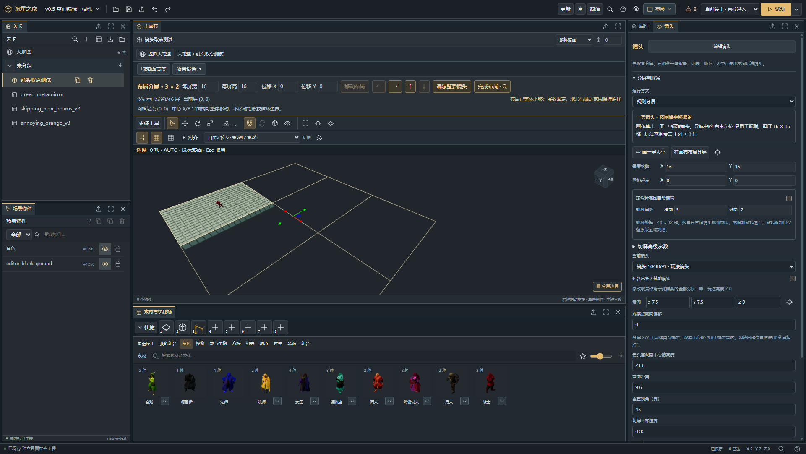
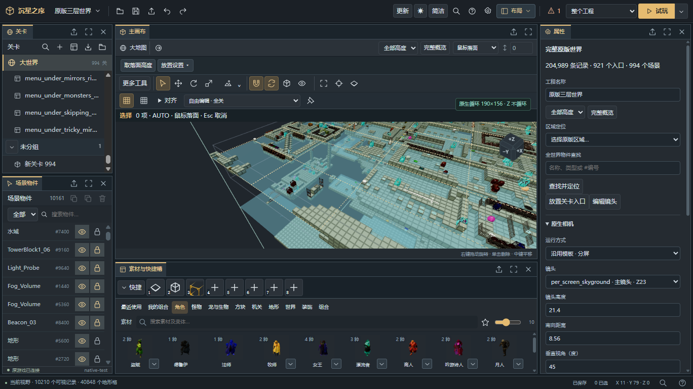

# 沉星之序 · 关卡工作台

面向 Windows 的非官方 3D 关卡编辑器。搭建地形、放置原生角色与机关、调整游戏镜头，在同一个工作台编辑完整原版世界及小关。原安装只读，试玩从受管副本启动，使用独立存档目录。

**v0.11.2** [Windows 安装版 / ZIP 下载](https://github.com/chenyehuan1234/sinking-star-editor/releases/tag/v0.11.2) · [更新记录](docs/RELEASE-NOTES.md#v0112--游戏更新后自动验证试玩存档) · [问题反馈](https://github.com/chenyehuan1234/sinking-star-editor/issues)

「我的工程」是启动首页。顶部可新建单关或工程，展开工程后可从分组目录中勾选小关，加入本机关卡库。关卡库有「我的关卡」和「已下载」，支持独立编辑与直接试玩。社区通过 gzip 分享包传输可编辑设计，桌面和独立网页共用目录。[本地预览与腾讯云国际站部署](community/README.md)

- 统一大地图入口与主角的移动操作。新增从头试玩整个工程，修复暂停菜单闪退和冰封屏障的原生状态写入。

- 顶部工程标签可切换、重排和拖出独立窗口。区域复制支持跨工程，保留地形、水域、玩法物件、入口与关联小关。
- 小关和自制大地图支持地板、墙面默认色与局部刷色。新增下落、荷叶、飞石和小车时序，以及西 1 式分屏通电高亮和三棱镜色卡。
- 分屏模板省略每屏尺寸时按原生 6×6 读取。新建分屏显式保存 16×16。[v0.10.0 发布说明](docs/RELEASE-NOTES.md#v0100--多工程与关卡机制)

游戏更新后替换现有试玩副本，首次复制和更新均显示实际进度。「操作设置 → 性能诊断」可记录选择、拖动、放置及素材读取耗时。下载包含 Windows x64 安装程序、免安装 ZIP 和 SHA-256 校验文件，无需另装 Node.js。[alpha.9 副本更新](docs/RELEASE-V09-ALPHA9.md) · [性能基准与空间盘点](docs/PERFORMANCE.md)

镜头栏集中展示本关画面规则、镜头清单、取景和特殊控制区域。双击镜头直接取景，“完成镜头编辑”恢复原自由视角。分屏边界开关位于画布上方图标栏，默认开启。[alpha.8 镜头工作台与取景更新](docs/RELEASE-V09-ALPHA8.md)

需要已安装的 Steam 原游戏。下载包不含原生资源，程序未签名。当前试玩隔离实测版本为 Build 26814241。

本版统一分屏规划、有限边界和导航，支持整套布局平移、一步撤销及返回大地图恢复视角；数字属性即时预览并自动提交，频道支持精确整数增减，连续输入合并撤销。地形外观、场景装饰、环境特效与辅助独立显示，水流默认展示全部可见水域。见 [alpha.6 说明](docs/RELEASE-V09-ALPHA6.md)及[镜头操作](docs/CAMERA-SWITCHING.md)。镜头编辑与原生运行能力分别说明；静态参考与游戏内切换分别验收。

此前新增镜头 G/R＋XYZ、画布取点和可视化分屏，见 [alpha.3 说明](docs/RELEASE-V09-ALPHA3.md)。同时包含此前修复（[alpha.2 说明](docs/RELEASE-V09-ALPHA2.md)）：

- 中键仅短促单击取样；长按、拖动、移回原点和滚轮导航都不取样。
- 大地图缩远继续显示原始地形和原生物件，不再自动切换简化缩略图。
- 装饰显示默认关闭；补齐原生阴影、无后缀 editorUI、cloud2 与相机标记的辅助分类。
- 地形与装饰按钮取消联动；关闭装饰仍保留设计地形。原生地面外观由独立模型构成，在原生材质视图与“地形外观”选项中查看，普通装饰开关独立。

- 关卡搜索默认收起为图标；物件按名称／模型识别，单击高亮、双击聚焦，画布选择同步定位列表。
- 地形碰撞与原版布景可独立锁定；水域可在装饰关闭时拖动，移动操纵柄提交后不再消失，布局菜单不再被方向控件遮挡。

本版保留 v0.9 的统一世界功能：

- **统一世界工作台**：完整 overworld 与小关使用相同的停靠布局、素材、属性和编辑工具，不再跳到另一套界面。按已连接的游戏版本读取完整目录。Build 26787118 包含 920 个入口和 998 个小关及辅助场景。
- **可整理的关卡目录**：以原生区域为初始分组，支持新建、改名、排序、跨组拖动及解散分组。只改变编辑组织，不改原生区域、进度或分镜。
- **自由世界浏览**：主画布按视野和任意 Z 范围加载；缩远保持原始地形格与原生物件，不自动切换缩略代理。地下、地表、天空是导航预设，不是拆开的三个工程。
- **小关与入口**：新建、独立复制、导入小关；在世界 XYZ 位置放置入口并选择目标。删除场景时检查入口与原生序列依赖，入口与场景可一起撤销；未处理的其他依赖会阻止删除。
- **自制大地图入口与镜头**：选中入口后通过缩略图更换样式，可编辑变换、入口解锁条件和分组；大地图设置中的「编辑大地图镜头」直接在画布取景。正常镜头、地图总览和分屏参数随工程保存，并写入大地图运行包。
- **v5 工程**：保存原生基础引用、场景目录和有序修改。v4 打开后另存 v5，保留旧文件；v3 继续读取。全世界构建保留原记录，不通过二维大地图重造。
- **三项修复**：门闸活动门体颜色与底座染色分别处理；中键保持位置松手才取样，任何移动只导航；原生地形材质显示切关后保持。

普通素材仍保留门闸类型、颜色和四种形态；频道与外观独立。旧错色门闸可在属性中使用“恢复素材颜色”，只修改染色及门体亮度。

工作台顶栏直接启动所选试玩范围。完整世界的循环穿越、跨层、解锁进度和本版门闸游戏内颜色仍待人工实测；自动构建通过不等于已通关验证。

## 编辑器截图

**alpha.8 镜头工作台**：镜头清单双击取景，精确参数和特殊控制区域可折叠；分屏摘要横排，边界开关位于上方图标栏。截图来自独立界面检查工程。


**alpha.6 的有限分屏布局**：测试工程规划为 3×2，空屏也保留，可用中央 X/Y 柄整体平移，不自动生成地形。



**v0.9 统一工作台**：原生大世界缩远后仍保留真实模型与逐格地形；图中测试工程另新增了一关和一个入口。




## 下载与首次启动

需要 Windows x64，以及通过 Steam 安装的《沉星之序 / Order of the Sinking Star》。下载包不包含原游戏资源，不需要另装 Node.js。

- **安装版**下载 `SinkingStarEditor-0.10.3-Setup.exe`，按向导安装。
- **免安装版**下载 `SinkingStarEditor-0.10.3-x64.zip`，完整解压后打开文件夹中的编辑器。
- GitHub 自动生成的 **Source code** 压缩包供开发者使用，不是可运行的软件下载。

启动时先检查已保存的目录，再查找 Steam 默认库和其他磁盘的游戏库。只有一个有效安装时自动连接；多个安装可选择。没有找到时，点击“选择游戏文件夹”，选择包含 `sinking_star.exe` 的目录，不是 Steam 总目录。

首次设置与工程菜单可查看工作区位置、选择其他磁盘。默认工作区在系统“文档”文件夹的 `SinkingStarEditor/workspace`；游戏目录和设置保存在当前 Windows 用户的应用数据目录。连接后更换工作区在重启时生效，旧工程不会自动搬迁。安装版与免安装版共用本机设置。

选择范围后点击试玩。要从未通关的状态测试整个工程，从试玩按钮旁的下拉选择「从头试玩整个工程」。关卡库试玩固定从所选关卡的初始状态进入。首次准备与空间检查进度显示在状态栏。试玩只能载入工作区的独立存档，显示与声音设置默认从原游戏只读复制。旧版本留下的测试战役可能仍出现在 Steam 的载入菜单。历史存档备份可在编辑器工作区的 `backups/saves-*` 查看。

当前安装程序与可执行文件未做代码签名。请从本仓库 Releases 下载，并核对同页的 `SHA256SUMS.txt`；Windows 可能显示未知发布者提示。

游戏更新后，旧工程仍可用当前安装打开。来源 Build 和数据指纹用于记录来源。旧模板或修改目标缺失时，属性栏与工程检查会列出具体问题，原始操作仍在工程中。跨版本打开后首次保存使用新文件名。编辑器会自动识别新版游戏的存档逻辑，并在每次试玩前核对实际使用的目录。只要游戏仍使用已支持的存档逻辑，更新后即可继续试玩。原生运行包需要实际引用有效。

## 可以做什么

- 新建空白关、按原版区域查找模板、复制关卡、组织大地图入口。
- 原生素材图卡、搜索、收藏、最近使用；外观与能力保持绑定。
- 拖入放置、半透明预览、多选、复制、移动、旋转、撤销与重做。
- 地面与墙体默认矩形铺设／擦除，自动工作面按鼠标实际命中面确定，空白区域回落到 Z=0；可手动锁定 XY、XZ、YZ。
- 中键单击取样物件或地形，拖动仍导航；“地形／机关”按钮记住上次配置，取样后可连续放置。
- 地形贴面笔刷、局部矩形／连续面拉伸、长按整数格微移，以及普通机关点选频道关联。
- 物件级隐藏、锁定、隔离、重叠选择；可保存的编辑分组，独立复制与一步撤销。
- 同类图卡批量切换、最多新增 2,000 个玩法物件的阵列；频道汇总与有方向的对象引用。
- 调整机关参数、频道与引用，复制独立组合。
- 原生循环关设置固定 X/Y 边界；角色按控制关联同步行动，支持独立控制与同步副本。
- 直接在主画布编辑游戏镜头，查看与编辑原生分屏及区域相机对象。
- 统一工作台保存草稿与自动恢复；完整世界保存为 v5，旧 v4 保留。支持单关、关卡组与整个工程试玩。
- 离线操作指南：`F1` 打开，`Ctrl+F` 检索；`Ctrl+Shift+P` 搜索执行命令；支持自定义快捷键。

## 循环关与角色多控

取消物件选择，在关卡设置的“循环与逻辑边界”中选择自定义边界，设置起点和格数，再开启水平循环。原生整数坐标是格子中心，Z 高度不循环。固定边界不会随新增物件自动扩大；原版模板缺省保留原生边界和遮罩。高级的方向覆盖用于原生重复画面，不等于独立轴的物理循环。

选中角色，在“原生角色控制”中设置各自独立、与现有角色同步，或复制为同步角色。原游戏以 `Guy.turn_order_id` 标识控制组，缺省使用自身 ID；同外观可以独立，不同外观也不会自动分组。更换外观预设保留控制关系。普通复制保留有效控制身份，与原组同步；明确创建独立副本时保留副本内部同步，并与原组独立。

上述配置读写和关联回归有自动检查；边界穿越、同时行动、变形及存在状态的游戏内行为仍由用户实测。

## 版本与限制

本次针对 Steam Build `26466613` 做原生数据、公开示例、空白关、区域相机和完整世界构建回归。较早版本的实机记录不等同于本次游戏内验收。

**自动界面检查与性能基准不等同于人工操作或游戏内通关验收。** 镜头动态切换、区域重叠优先级、特殊机关与怪物门房间归属仍需实际游戏对照。区域导航显示空间命中和候选镜头，不冒充原游戏最终判定。

工程绑定创建时的游戏版本和源包。游戏更新后，旧工程可能提示来源不匹配；原文件不会被覆盖，v3 工程仅在来源结构与资源依赖校验通过后适配并另存；v4／v5 世界暂时要求相同来源版本。原生素材解析失败会报告错误，不保证全部特殊对象可独立放置。

发现未知游戏版本时会检查必要结构并显示验证状态；通过结构解析不代表游戏内机制已验证。无需登录编辑器账号，无遥测；联网更新检查可提示新版本，下载和安装由用户确认。

## 从源码构建

需要 Node.js 22 或更高版本。源码构建不需要原游戏文件或个人工作区：

```powershell
npm ci
npm run typecheck
npm test
npm run package
```

`npm test` 不要求原游戏，缺少环境变量时明确跳过原生集成项目；其余通用测试使用自行构造的数据和临时文件。`npm run package` 生成安装程序与 ZIP，输出在 `release-public`。

开发运行：`npm start`。

对自己安装的原游戏做只读集成检查：

```powershell
$env:SINKING_STAR_GAME = 'X:\SteamLibrary\steamapps\common\Order of the Sinking Star'
npm run test:native
npx tsx scripts/verify-public.ts
```

这些自动检查不启动游戏、不部署到原安装、不切换存档。文件操作测试使用临时目录中的非可执行模拟文件。

可选开发启动变量：`SINKING_STAR_WORKSPACE` 指定工作区；`SINKING_STAR_USER_DATA` 指定独立应用配置。显式指定工作区时，界面不会覆盖该设置。

公开示例是设计描述，连接游戏后从本机原生对象生成并检查依赖，不携带模型、贴图、原生记录快照或固定游戏哈希。

## 许可

编辑器代码和原创设计描述采用 [MIT 许可](LICENSE)。原游戏及其素材归各自权利人所有，不属于本仓库许可范围。参见 [第三方许可说明](THIRD_PARTY_NOTICES.md)。

本项目是非官方玩家工具，与 Thekla, Inc. 无隶属或背书关系。


## v0.7.9 操作效率

先选中物件，方向键沿世界 X/Y 微移，Shift+PageUp/PageDown 沿 Z 微移。按住 300ms 后每 80ms 重复，全部释放合为一步撤销；Esc 或失焦取消。地形拉伸默认先框选局部裸露面，再拖法线箭头或输入正负层数；最多 4,096 格、128 层，不补齐孔洞。

物件列表的眼睛和锁只影响本机编辑视图。编辑分组随 v3 工程保存，但不改变原生存在组、角色同步或机关频道。关系默认只显示选中相关，可切换当前频道和全部关系；怪物门及特殊开关不进入普通频道图。

预览和重型校验在后台线程执行，解析模板复用；提交返回实体与地形块差量。拖动期间只更新本地场景，提交后保留位置直到结果确认。性能数据、测量范围和复现方法见 [性能记录](docs/PERFORMANCE.md)。完整循环大地图、多层世界及解锁进度留待后续版本。


## 浏览位置记忆

原版关卡目录记住搜索、展开区域、辅助场景开关和滚动位置，添加后重新打开原位返回。素材各分类、收藏和最近使用分别记住搜索、所选变体及位置；折叠面板或重启仍可恢复，调整窗口和缩略图大小时保持原物件可见。重新打开工程回到上次小关，已删除时回到大地图。

这些记录只保存在本机，不改变工程文件、未保存状态或撤销历史。不同游戏源包的原版目录记录隔离；主素材库和属性配置图卡的记录也分别保存。


## v0.7.10 快捷素材与精确取景

素材栏新增八个快捷槽：`1–8` 启用，`Ctrl+1–8` 保存当前取样或单个选中物件，拖入图卡只绑定。完整原生配置独立保存在本机；副本 ID、频道和角色身份独立，锁定高度按工程、关卡及槽位记忆。右键槽位可更新、改名或清空。

地形支持拖动矩形与固定尺寸，显示实际工作面、起点、长×宽×厚。厚度 1–128 层，每笔最多 4,096 格，预览与提交共用同一份格子结果。大地图仍为 XY、一层地图格。

自由视角可通过“采用当前视角”保存为单场景游戏镜头。主画布镜头编辑支持 16:9、4:3、21:9 和跟随视口的构图留边；比例不改变游戏分辨率。新空白关扩建出框只提示，不自动覆盖镜头。分屏、总览、动态引用及翻转视角保留原生限制。

## v0.7.11 自由工作区

顶栏“布局”提供 23 类独立面板，包括镜头、区域相机、机关关系、显示、循环、分组、阵列、原版关卡目录、设置和指南。拖动标题到边缘拆分、到中间合并标签；标题右侧可浮动、最大化或关闭。浮动面板在当前编辑器窗口内移动和缩放。

双击标题最大化／恢复；Tab 聚焦主画布／恢复原布局。支持布局锁定、标准／地形编辑／机关设计预设和命名布局保存。当前布局、关闭前的停靠位置、搜索及滚动位置在本机恢复，不改变工程内容或撤销历史。部分原有窗口可通过右上角的停靠按钮转到工作区。

## 水域与水流（v0.7.12）

点击画布工具栏的水流图标，或在“布局”打开“水域与水流”。选择现有水域；空白关可新建普通静水，输入 X/Y/Z 和宽高。选择方向与连续画线／拖动矩形，点“开始在画布绘制”，左键拖动、松手提交。R／Shift+R 转向；右键单击或 Esc 退出，右键拖动仍旋转镜头。每笔可一步撤销。

原版水域可以整片铺底，再用地形覆盖；地形下的水格和流向仍保留。Z 是玩法高度，默认水面下沉 0.1 格；高架桥不被当作下层水域孔洞。隐藏水面和箭头是显示遮挡，不会擦除原生水格。

“清除流向”保留静水，“擦除水面”制造孔洞，“补水”填回孔洞。调整范围保留交集的水格与流向；地形不会自动被水域删除。水流只绘制在选中普通水域的已有水格上，单笔最多 4,096 格。需要更换原生水材质时展开素材卡片；“仅阻挡玩家”的水域需先转为普通类型才能画流向。

绘制预览与箭头只在本地更新，松手后写入原生水格；传播、转弯和物件运动交由原游戏。编辑水面和缩略图是轻量示意，不播放原版水波。原游戏内运动效果仍待用户实测，详见验收步骤。

### alpha.3 操作更新

撤销左侧可打开导出：单关／关卡组／整个工程，选择本机位置，输出可编辑工程或原生运行数据文件夹。原生包需要匹配版本游戏资源。

检查列表支持滚动、筛选、搜索与定位；双击物件切到属性。装饰显隐与地形材质分开，简洁模式保留装饰图标，特殊云层与灯光辅助默认隐藏。门闸默认高度修正为1，R旋转同步原生方向，旧工程显式高度保留。游戏内开合、跨层阻挡与安装升级仍需用户实测。

## 本地镜头操作更新（尚未上传）

镜头编辑采用中键抓住场景平移、右键围绕观察中心旋转；默认 G/R 后按 XYZ 约束，移动柄和旋转环分开显示。坐标旁的取点图标支持画布选点、三轴微调及一步撤销。规则分屏在主画布设置起点和每屏宽高，点击一屏检查整套取景，不逐屏创建相机。分屏统计不改变地形或循环范围。详细操作见 F1 指南中的“游戏镜头”。

本地 alpha.4 将镜头与分层区域合并，分屏线常驻，支持自动铺满／手动横纵数量，以及画矩形设置一屏大小和循环边界。见 [说明](docs/RELEASE-V09-ALPHA4.md)。
