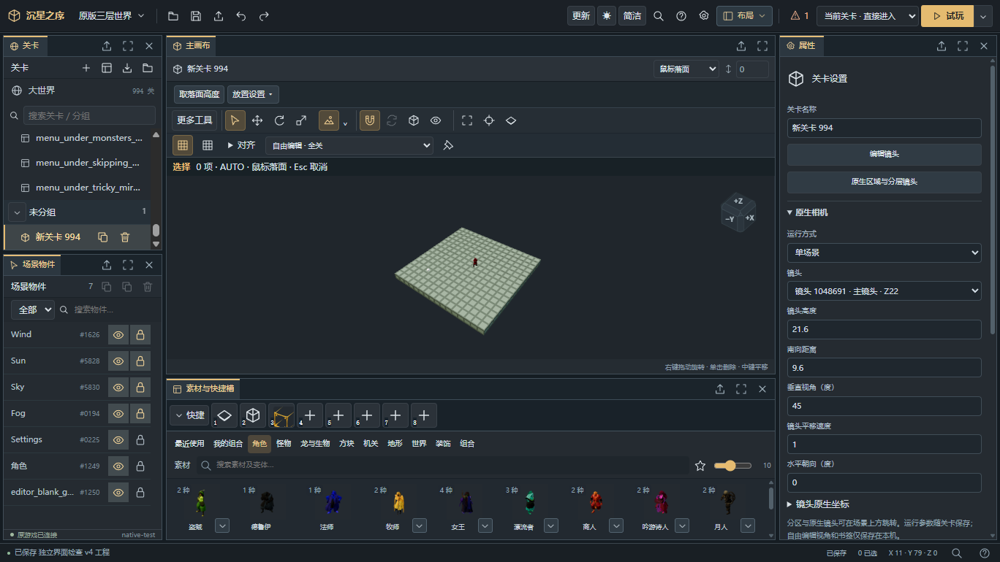
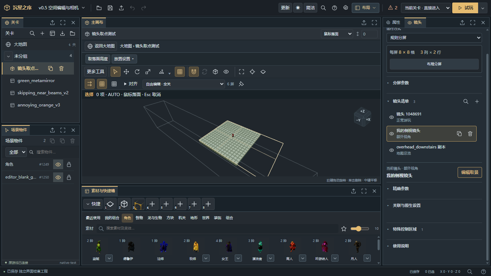

# 沉星之序 · 关卡工作台

面向 Windows 的《沉星之序》（Order of the Sinking Star）非官方 3D 关卡编辑器。你可以从空白场景设计一道谜题，也可以导入原版模板，或制作串联多个小关的大地图。

**当前版本 v0.12.4** · [下载 Windows 版](https://github.com/chenyehuan1234/sinking-star-editor/releases/latest) · [更新记录](docs/RELEASE-NOTES.md#v0124--列表试玩与按组补图) · [问题反馈](https://github.com/chenyehuan1234/sinking-star-editor/issues)

## 下载与首次启动

需要 **Windows x64** 和通过 Steam 安装的《沉星之序》。发行包提供编辑器所需的运行环境，游戏素材从本机安装读取。

1. 在发布页的 **Assets** 下载 `*-Setup.exe` 安装版，或下载 `*-x64.zip` 免安装版。使用 ZIP 时完整解压，再打开文件夹里的编辑器。`Source code` 是源码入口。
2. 可以用 PowerShell 的 `Get-FileHash -Algorithm SHA256` 核对下载文件和同页 `SHA256SUMS.txt` 里的值。程序目前未签名，Windows 可能提示未知发布者。
3. 启动后，编辑器会检查已连接的目录和 Steam 各磁盘的库。自动检测失败时，点击「选择游戏文件夹」，选中包含 `sinking_star.exe` 的游戏安装目录。
4. 默认工作区位于系统「文档」下的 `SinkingStarEditor/workspace`。可在首次设置或工程菜单更换目录。重启后使用新位置，原有工程留在原目录。

## 做一个小关

1. 在「我的工程」点「新建单关」。单关适合单独设计一道谜题，需要多个关卡入口时可用「新建工程」。
2. 从素材栏拖入方块、开关、门闸和出口。选中物件后，在属性面板调整方向、高度和关联。地面与墙体可拖出矩形区域批量铺设。
3. 用 `Ctrl+S` 保存。新文件会询问保存位置。已有工程直接保存到原路径，跨游戏 Build 适配后首次覆盖会保留备份。
4. 在顶栏选择试玩范围，启动游戏检验通路和机关。也可以回到「我的工程」，在小关行上点击「临时试玩」。

按 `F1` 打开内置指南，或按 `Ctrl+F` 搜索操作说明。`Ctrl+Shift+P` 打开命令搜索，快捷键可在操作设置中调整。

## 编辑器功能

| 任务 | 工作台支持 |
| --- | --- |
| 设计谜题 | 整数格与分层编辑、地面和墙体、逐格水流、原生角色与机关、频道和对象关联、循环边界、角色同步控制。 |
| 调整场景 | 拖放虚像、中键单击取样、多选和分组、区域复制、阵列、撤销与重做。素材支持搜索、收藏、最近使用和快捷槽。 |
| 制作大地图 | 在自制世界中布置小关入口和解锁条件。完整原版世界可作为一个工程导入，地表、地下与天空可分层浏览。 |
| 设置镜头 | 在主画布取景，配置普通游玩镜头、规则分屏、总览和辅助视角。 [镜头操作说明](docs/CAMERA-SWITCHING.md) |
| 管理工程 | 多工程标签可拖出为独立窗口。支持单关独立编辑及导入其他工程、草稿恢复，以及按范围导出可编辑设计或原生运行包。 |



统一工作台的小关入口编辑，摄于 v0.9。


完整原版世界浏览，摄于 v0.9。



镜头工作台，摄于 v0.9 alpha.8。

## 关卡库与社区

- **我的工程**可展开查看分组和小关。工程行提供大地图预览和临时试玩，每个小关行也有独立入口。可勾选小关加入本机关卡库。
- **关卡库**分为「我的关卡」和「已下载」。收录的单关可独立编辑，也能导入其他工程。立方体图标打开 3D 弹窗，左键旋转、中键平移、滚轮缩放。
- **桌面关卡社区**可按作品、作者、关卡名或标签检索。单关列表可直接下载、打开 3D 或临时试玩，工程列表也可临时试玩。网页提供图片预览、浏览和下载。 [打开网页版社区](https://sinking-star-community-preview.lingxiao-clubhub.workers.dev/)
- **发布作品**可选择单关或完整工程，填写简介并添加预设或自定义标签。首次在桌面端发布需填写用户名，登录凭据在本机加密保存。「我的发布」可修改说明、更新版本或下架。工程先传封面，作者在桌面社区展开关卡组时补传该组缺少的缩略图。 [社区使用与部署说明](community/README.md)

## 试玩与存档

编辑器从受管游戏副本启动试玩，并在启动前检查副本实际使用的独立存档路径。首次准备或游戏更新后同步副本需要时间。原游戏安装供编辑器只读使用。

「临时试玩」每次从初始进度开始，游戏退出后清理这次的试玩进度。常规试玩的进度保存在编辑器的试玩存档中。遇到原游戏更新、缺少资源或存档路径校验失败，可在编辑器中查看具体提示。版本的自动检查和游戏内验收范围见发布说明。 [试玩隔离说明](docs/PLAYTEST-ISOLATION.md) · [更新记录](docs/RELEASE-NOTES.md)

## 从源码运行与构建

使用 Node.js 22 或更高版本。在仓库根目录运行以下命令，启动开发版。

```powershell
npm ci
npm start
```

在 Windows 上执行检查并打包。

```powershell
npm run typecheck
npm test
npm run package -- --publish never
npm run verify:release
```

发行文件生成在 `release-public`。通用检查可在未安装游戏的环境执行。连接本机 Steam 安装后可运行原生集成检查。 [工程格式](docs/FORMAT.md) · [性能记录](docs/PERFORMANCE.md)

## 许可

编辑器代码和仓库内的原创设计描述采用 MIT 许可。原游戏及其素材的权利归各自权利人所有。本项目由玩家独立维护，与 Thekla, Inc. 无隶属或授权关系。 [MIT 许可](LICENSE) · [第三方许可](THIRD_PARTY_NOTICES.md)
