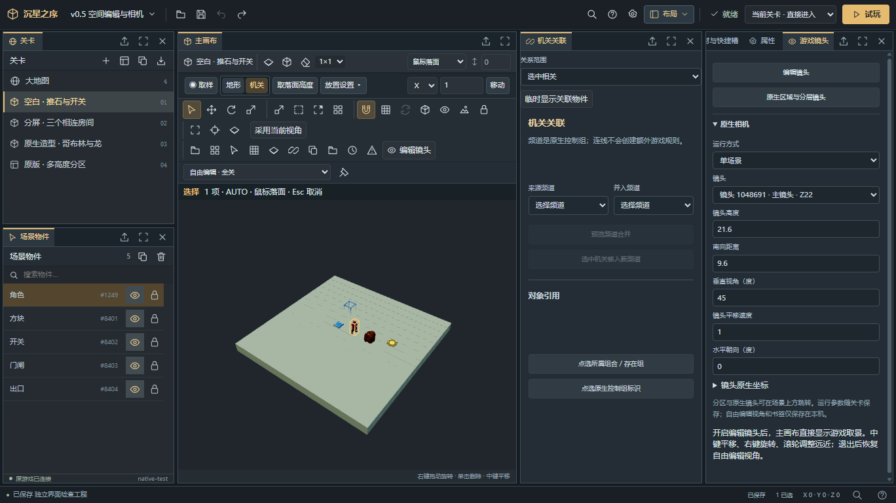
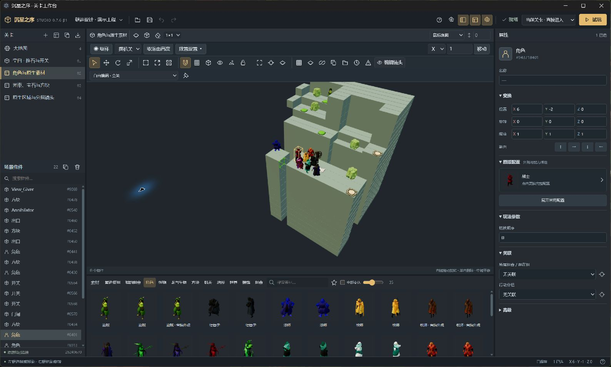
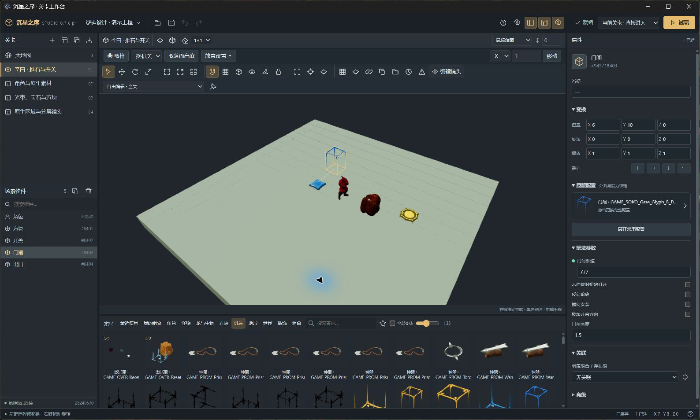
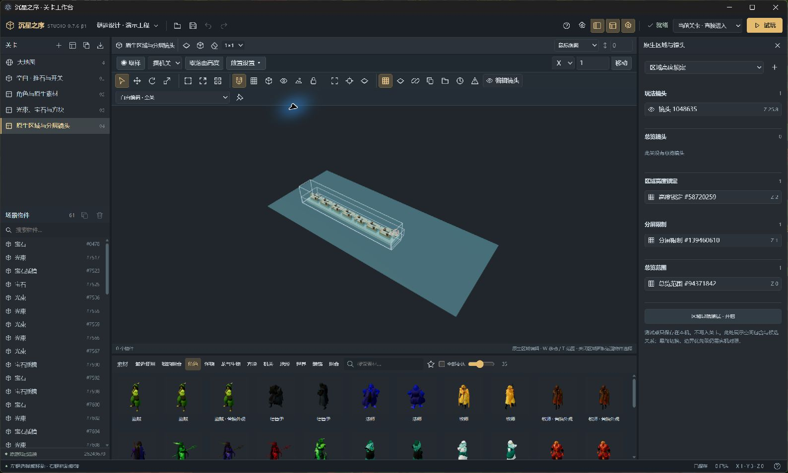

> **v0.7.13-beta.1 测试版**：新增地形左右键矩形操作、相机轴向对齐与正交视图、简洁模式、浅色主题和更新入口。试玩继续使用专用测试副本。跨版本不再只看整体哈希，但仅在工程保存的原生结构与依赖记录匹配时适配，缺少记录或依赖已改变的旧工程仍不能自动迁移。详见 [本轮验收记录](docs/V0713-ACCEPTANCE.md)。

# 沉星之序 · 关卡工作台

面向 Windows 的非官方 3D 关卡编辑器。搭建地形、放置原生角色与机关、调整游戏镜头，并使用原游戏试玩自己的谜题。

**[下载 v0.7.13-beta.1 测试版](https://github.com/chenyehuan1234/sinking-star-editor/releases/tag/v0.7.13-beta.1)** · [问题反馈](https://github.com/chenyehuan1234/sinking-star-editor/issues) · [使用与验收步骤](docs/USER-TEST.md)

**v0.7.12-beta.3 修复游戏更新后的试玩准备**：自动保留已登记的旧版副本，校验后重新复制当前游戏；新建单关无需手动清理旧副本。

**v0.7.12-beta.2 修正原版水域坐标、上下层水位及地形遮挡**。水域保留完整底层，地形覆盖水面，箭头仅显示露出的水面。

**v0.7.12 新增水流编辑**：创建水域，直接画四向水流、矩形清流、补水与擦孔洞。水域图卡默认合并为两类，原生外观变体仍可展开选择。

## 编辑器截图

**v0.7.11 自由停靠工作区**：关卡、物件、主画布、机关关系和游戏镜头可以独立拆分，属性及其他页面可合并为标签。



以下为 v0.7.6-beta.1 的实际编辑器界面，使用独立演示工程截取。

**3D 工作区与角色素材库**：场景选择、原生角色图卡与右侧属性面板。



**物件参数编辑**：选中门闸后查看变换、原版配置、玩法参数及关联。



**原生区域相机**：查看玩法镜头、高度锁定、分屏限制与总览范围。



## 下载与首次启动

需要 Windows x64，以及通过 Steam 安装的《沉星之序 / Order of the Sinking Star》。下载包不包含原游戏资源，不需要另装 Node.js。

- **安装版**：下载 `SinkingStarEditor-0.7.12-beta.3-Setup.exe`，按向导安装。
- **免安装版**：下载 `SinkingStarEditor-0.7.12-beta.3-x64.zip`，完整解压后打开文件夹中的编辑器。保留整个文件夹，不要只移动 exe。
- GitHub 自动生成的 **Source code** 压缩包供开发者使用，不是可运行的软件下载。

启动时先检查已保存的目录，再查找 Steam 默认库和其他磁盘的游戏库。只有一个有效安装时自动连接；多个安装可选择。没有找到时，点击“选择游戏文件夹”，选择包含 `sinking_star.exe` 的目录，不是 Steam 总目录。

首次设置与工程菜单可查看工作区位置、选择其他磁盘。默认工作区在系统“文档”文件夹的 `SinkingStarEditor/workspace`；游戏目录和设置保存在当前 Windows 用户的应用数据目录。连接后更换工作区在重启时生效，旧工程不会自动搬迁。安装版与免安装版共用本机设置。

首次试玩会在工作区复制一份完整游戏，并保留原包备份。游戏更新后会重新计算空间，先准备并校验新版，再将旧试玩副本及登记文件保留到工作区 backups/test-copy-*，最后切换副本。估算阶段不改文件；准备副本不会修改工程或激活测试战役。所需空间取决于游戏版本，准备前会计算并检查可用空间；空间不足时可更换工作区。原安装保持只读，试玩使用专用测试战役。游戏运行时不部署副本或切换战役，编辑器不会替你关闭游戏。

当前安装程序与可执行文件未做代码签名。请从本仓库 Releases 下载，并核对同页的 `SHA256SUMS.txt`；Windows 可能显示未知发布者提示。

## 可以做什么

- 新建空白关、按原版区域查找模板、复制关卡、组织大地图入口。
- 原生素材图卡、搜索、收藏、最近使用；外观与能力保持绑定。
- 拖入放置、半透明预览、多选、复制、移动、旋转、撤销与重做。
- 地面与墙体默认矩形铺设／擦除，自动工作面按鼠标实际命中面确定，空白区域回落到 Z=0；可手动锁定 XY、XZ、YZ。
- 中键单击取样物件或地形，拖动仍导航；“地形／机关”按钮记住上次配置，取样后可连续放置。
- 地形贴面笔刷、局部矩形／连续面拉伸、长按整数格微移，以及普通机关点选频道关联。
- 物件级隐藏、锁定、隔离、重叠选择；可保存的编辑分组，独立复制与一步撤销。
- 同类图卡批量切换、最多新增 2,000 个玩法物件的阵列；频道汇总与有方向的对象引用。
- 调整机关参数、频道与引用，复制独立组合。
- 原生循环关设置固定 X/Y 边界；角色按控制关联同步行动，支持独立控制与同步副本。
- 直接在主画布编辑游戏镜头，查看与编辑原生分屏及区域相机对象。
- 保存草稿与自动恢复；试玩当前关、临时关卡组或整个工程。
- 离线操作指南：`F1` 打开，`Ctrl+F` 检索；`Ctrl+Shift+P` 搜索执行命令；支持自定义快捷键。

## 循环关与角色多控

取消物件选择，在关卡设置的“循环与逻辑边界”中选择自定义边界，设置起点和格数，再开启水平循环。原生整数坐标是格子中心，Z 高度不循环。固定边界不会随新增物件自动扩大；原版模板缺省保留原生边界和遮罩。高级的方向覆盖用于原生重复画面，不等于独立轴的物理循环。

选中角色，在“原生角色控制”中设置各自独立、与现有角色同步，或复制为同步角色。原游戏以 `Guy.turn_order_id` 标识控制组，缺省使用自身 ID；同外观可以独立，不同外观也不会自动分组。更换外观预设保留控制关系。普通独立复制会保留副本之间的组内关系，并与原组独立。

上述配置读写和关联回归有自动检查；边界穿越、同时行动、变形及存在状态的游戏内行为仍由用户实测。

## 版本与限制

本次发布针对 Steam Build `26249670` 做数据解析、示例生成、空白关和区域相机的自动回归。较早 Build `26006400` 的验证为历史记录，不等同于本次实机结果。

**自动界面检查与性能基准不等同于人工操作或游戏内通关验收。** 镜头动态切换、区域重叠优先级、特殊机关与怪物门房间归属仍需实际游戏对照。区域导航显示空间命中和候选镜头，不冒充原游戏最终判定。

工程绑定创建时的游戏版本和源包。游戏更新后，旧工程可能提示来源不匹配；原文件不会被覆盖，本版不提供跨游戏版本的自动迁移。原生素材解析失败会报告错误，不保证全部特殊对象可独立放置。

发现未知游戏版本时会检查必要结构并显示验证状态；通过结构解析不代表游戏内机制已验证。无需登录编辑器账号，无遥测、无自动更新。

## 从源码构建

需要 Node.js 22 或更高版本。源码构建不需要原游戏文件或个人工作区：

```powershell
npm ci
npm run typecheck
npm test
npm run package
```

`npm test` 不要求原游戏，缺少环境变量时明确跳过原生集成项目；其余通用测试使用自行构造的数据和临时文件。`npm run package` 生成安装程序与 ZIP，输出在 `release-public`。

开发运行：`npm start`。

对自己安装的原游戏做只读集成检查：

```powershell
$env:SINKING_STAR_GAME = 'X:\SteamLibrary\steamapps\common\Order of the Sinking Star'
npm run test:native
npx tsx scripts/verify-public.ts
```

这些自动检查不启动游戏、不部署到原安装、不切换存档。文件操作测试使用临时目录中的非可执行模拟文件。

可选开发启动变量：`SINKING_STAR_WORKSPACE` 指定工作区；`SINKING_STAR_USER_DATA` 指定独立应用配置。显式指定工作区时，界面不会覆盖该设置。

公开示例是设计描述，连接游戏后从本机原生对象生成并检查依赖，不携带模型、贴图、原生记录快照或固定游戏哈希。

## 许可

编辑器代码和原创设计描述采用 [MIT 许可](LICENSE)。原游戏及其素材归各自权利人所有，不属于本仓库许可范围。参见 [第三方许可说明](THIRD_PARTY_NOTICES.md)。

本项目是非官方玩家工具，与 Thekla, Inc. 无隶属或背书关系。


## v0.7.9 操作效率

先选中物件，方向键沿世界 X/Y 微移，Shift+PageUp/PageDown 沿 Z 微移。按住 300ms 后每 80ms 重复，全部释放合为一步撤销；Esc 或失焦取消。地形拉伸默认先框选局部裸露面，再拖法线箭头或输入正负层数；最多 4,096 格、128 层，不补齐孔洞。

物件列表的眼睛和锁只影响本机编辑视图。编辑分组随 v3 工程保存，但不改变原生存在组、角色同步或机关频道。关系默认只显示选中相关，可切换当前频道和全部关系；怪物门及特殊开关不进入普通频道图。

预览和重型校验在后台线程执行，解析模板复用；提交返回实体与地形块差量。拖动期间只更新本地场景，提交后保留位置直到结果确认。性能数据、测量范围和复现方法见 [性能记录](docs/PERFORMANCE.md)。完整循环大地图、多层世界及解锁进度留待后续版本。


## 浏览位置记忆

原版关卡目录记住搜索、展开区域、辅助场景开关和滚动位置，添加后重新打开原位返回。素材各分类、收藏和最近使用分别记住搜索、变体显示及位置；折叠面板或重启仍可恢复，调整窗口和缩略图大小时保持原物件可见。重新打开工程回到上次小关，已删除时回到大地图。

这些记录只保存在本机，不改变工程文件、未保存状态或撤销历史。不同游戏源包的原版目录记录隔离；主素材库和属性配置图卡的记录也分别保存。


## v0.7.10 快捷素材与精确取景

素材栏新增八个快捷槽：`1–8` 启用，`Ctrl+1–8` 保存当前取样或单个选中物件，拖入图卡只绑定。完整原生配置独立保存在本机；副本 ID、频道和角色身份独立，锁定高度按工程、关卡及槽位记忆。右键槽位可更新、改名或清空。

地形支持拖动矩形与固定尺寸，显示实际工作面、起点、长×宽×厚。厚度 1–128 层，每笔最多 4,096 格，预览与提交共用同一份格子结果。大地图仍为 XY、一层地图格。

自由视角可通过“采用当前视角”保存为单场景游戏镜头。主画布镜头编辑支持 16:9、4:3、21:9 和跟随视口的构图留边；比例不改变游戏分辨率。新空白关扩建出框只提示，不自动覆盖镜头。分屏、总览、动态引用及翻转视角保留原生限制。

## v0.7.11 自由工作区

顶栏“布局”提供 23 类独立面板，包括镜头、区域相机、机关关系、显示、循环、分组、阵列、原版关卡目录、设置和指南。拖动标题到边缘拆分、到中间合并标签；标题右侧可浮动、最大化或关闭。浮动面板在当前编辑器窗口内移动和缩放。

双击标题最大化／恢复；Tab 聚焦主画布／恢复原布局。支持布局锁定、标准／地形编辑／机关设计预设和命名布局保存。当前布局、关闭前的停靠位置、搜索及滚动位置在本机恢复，不改变工程内容或撤销历史。部分原有窗口可通过右上角的停靠按钮转到工作区。

## 水域与水流（v0.7.12）

点击画布工具栏的水流图标，或在“布局”打开“水域与水流”。选择现有水域；空白关可新建普通静水，输入 X/Y/Z 和宽高。选择方向与连续画线／拖动矩形，点“开始在画布绘制”，左键拖动、松手提交。R／Shift+R 转向；右键单击或 Esc 退出，右键拖动仍旋转镜头。每笔可一步撤销。

原版水域可以整片铺底，再用地形覆盖；地形下的水格和流向仍保留。Z 是玩法高度，默认水面下沉 0.1 格；高架桥不被当作下层水域孔洞。隐藏水面和箭头是显示遮挡，不会擦除原生水格。

“清除流向”保留静水，“擦除水面”制造孔洞，“补水”填回孔洞。调整范围保留交集的水格与流向；地形不会自动被水域删除。水流只绘制在选中普通水域的已有水格上，单笔最多 4,096 格。需要更换原生水材质时展开素材变体；“仅阻挡玩家”的水域需先转为普通类型才能画流向。

绘制预览与箭头只在本地更新，松手后写入原生水格；传播、转弯和物件运动交由原游戏。编辑水面和缩略图是轻量示意，不播放原版水波。原游戏内运动效果仍待用户实测，详见验收步骤。
