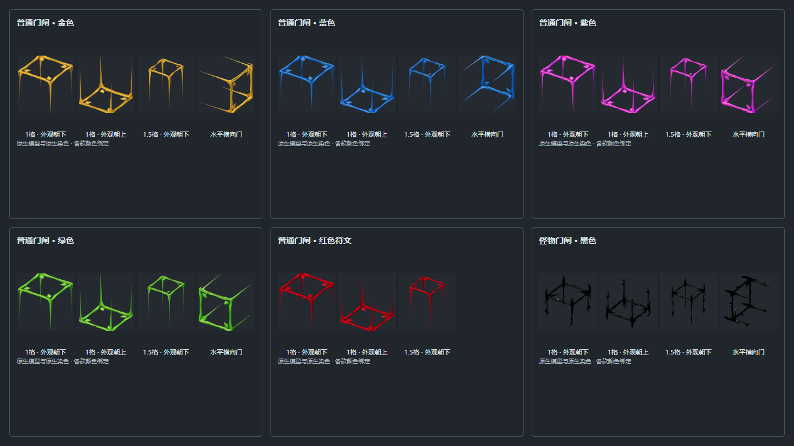

# v0.8.0-alpha.6：修复门闸颜色

上一版按模型系列整理素材时，混入了原版个别关卡的自定义染色：紫色朝上款使用了金色，绿色朝上款使用了蓝色，部分横向款色调也不同。本版修复颜色绑定。

- 同一颜色组的四款外观统一使用组内原生染色参考，颜色参数随预设进入缩略图、放置虚像、连续放置、快捷槽与原生运行数据。
- 切换朝上／朝下／横向、反转开合或R旋转，保留所选颜色；改变频道不换色。
- 选中已有错色门闸，在属性开合方向区域点击“恢复素材颜色”。此操作只改原生染色字段，保留ID、位置、名称、频道、响应、开合方向及引用，可以撤销。颜色匹配时不显示额外按钮。
- 不自动重写已有工程或历史配置的颜色；旧原版关卡中的自定义染色仍按原记录读取。
- 属性栏当前配置预览显示物件实际染色；切换门闸外观时保留原频道。
- 更新门闸缩略图缓存版本，保留其他素材缓存。

## 检查结果

- 类型检查通过。
- 完整通用／原生读取、写回与构建回归277项通过；无原游戏环境182项通过，95项原生检查明确跳过。
- 原生检查逐一比对23款门闸的预览颜色及写出重读后的染色值；已有错色门闸恢复后，所有非染色字段保持一致。
- 独立Electron自动界面检查42项通过，包含六组颜色、23张真实模型缩略图、颜色恢复按钮及既有试玩、配置、快捷槽、方向和布局回归。覆盖1366×768、1920×1080及125%缩放。
- 界面试玩使用模拟启动；没有进行本版游戏内机制或安装升级实测。正式存档和Steam原安装不参与测试操作。

提供Windows x64安装程序、ZIP及SHA-256校验文件，程序未签名。保存工程并退出旧窗口后启动新版；查看素材库同色四款，重点核对紫色、绿色的朝上及横向款。已有错色对象可手动恢复颜色后保存、重开，再使用隔离试玩核对。
